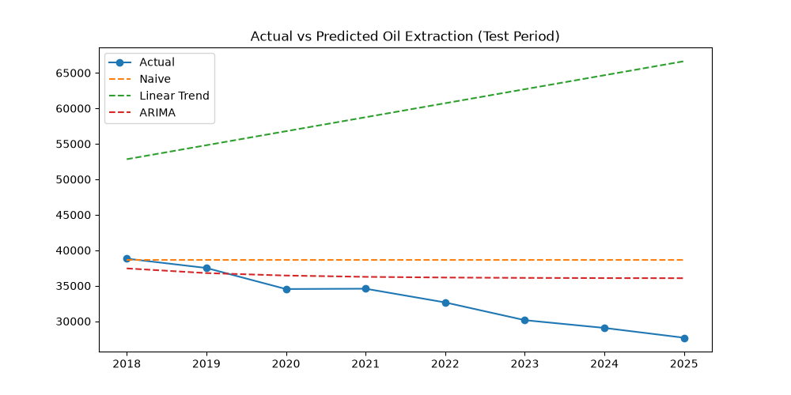

# Azerbaijan Crude Oil Extraction Forecast

## Goal
Forecast Azerbaijan's annual crude oil extraction using historical data (1871–2025),
testing whether simple models can anticipate the post-2010 decline.

## Data
Source: State Statistical Committee of Azerbaijan (stat.gov.az), table 5.1.
Range used for modeling: 1994–2025 (post-independence, more stable regime).
Train: 1994–2017. Test: 2018–2025.

## Approach
1. Naive baseline (repeat last value)
2. Linear trend regression
3. ARIMA(1,1,0)

## Results
| Model  | MAE (thousand tonnes) |
|--------|-----------------------|
| Naive  | 5,601.5               |
| Linear | 26,613.4              |
| ARIMA  | 3,817.8               |



## Conclusion
ARIMA had the lowest error, but all models forecast an essentially flat line and
none captured the ongoing decline. The linear model was worst because it extrapolated
the post-2005 rise. Limitations: only 32 yearly points, and no external drivers
(oil prices, OPEC+ quotas).

## How to run
```
pip3 install pandas matplotlib scikit-learn statsmodels
python3 main.py
```
